# 1.8 — Project card

## Changed

API-backed, reusable `ProjectCard` using the shared entity and UI components/tokens. Hover flips on pointer devices; touch flips once and opens the project URL on a second body tap; keyboard users have an explicit flip control. The See more/author rail stays fixed on both faces. Inactive faces are inert. Reduced motion fades instead of rotating.

Front: preview/fallback, name/tagline, category, stage/Studio column, license/copyleft, forks/stars, template. Back: full description, GitHub/demo/release, copy clone with failure fallback, license summary, self-reported build facts. Unlicensed cards are excluded by preference at both host and component level and never expose clone instructions.

A minimal `FeedPage` hosts real API responses for card testing. Search, sort, filters, and pagination remain task 1.10. See more points at the existing `/p/:slug` route; its panel remains task 1.9.

## Test

1. `pnpm install`, `pnpm dev` (http://127.0.0.1:8788).
2. Hover a card; use Flip card/Show preview with Enter or Space. Check the stationary See more/author links and copy-clone action.
3. At 375 px, tap the non-interactive card body once for its back, twice to navigate. Test the WIP/copyleft and curated long-text fixtures.
4. Sign in at `/api/dev/login?as=fx-ada` and `fx-admin`, or sign out at `/api/dev/logout`.
5. `playwright test -c e2e/playwright.config.ts` (requires the requested root runner dependency). The local test run used the existing Codex bundled playwright 1.62.1 through an ignored e2e/node_modules/playwright junction.
6. Optional manual state QA: `node e2e/browser-state-proxy.mjs`; open `http://127.0.0.1:8798/__qa?mode=empty`, `error`, or `loading`. This test-only proxy forwards the real dev app and substitutes feed response states. `mode=fixture` restores upstream responses. It is never imported into the app/build.

Validation: pnpm check passes (154 unit/API/integration tests after rebasing the 1.1–1.7 checkpoints, typecheck, lint, builds, no-fixtures gate). Playwright: 15 pass, 1 intentional desktop touch-only skip; both 375×812 and 1440×1000. Includes signed-out/Ada/admin, keyboard, hover/touch, reduced motion, long text, no preview, unlicensed opt-in/no-clone, loading/empty/error/retry, and card bounds against the requested viewport. Screenshot review caught and fixed aspect-ratio overflow.

Computer-use verification: clicked/keyboard-flipped the long-text and WIP cards, checked the opt-in no-license back, signed-in header, desktop reduced-motion back, and loading/empty/error/retry via the local QA proxy. Test preferences were restored after inspection.

## Screenshots

| State | 375 px | 1440 px |
| --- | --- | --- |
| Fronts | 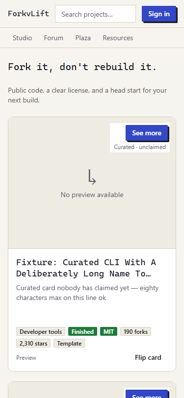 | 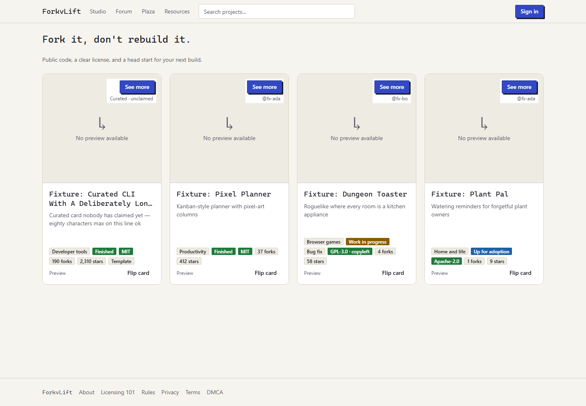 |
| Back / reduced motion | 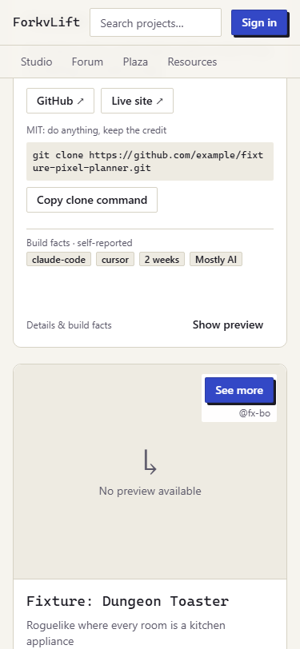 | 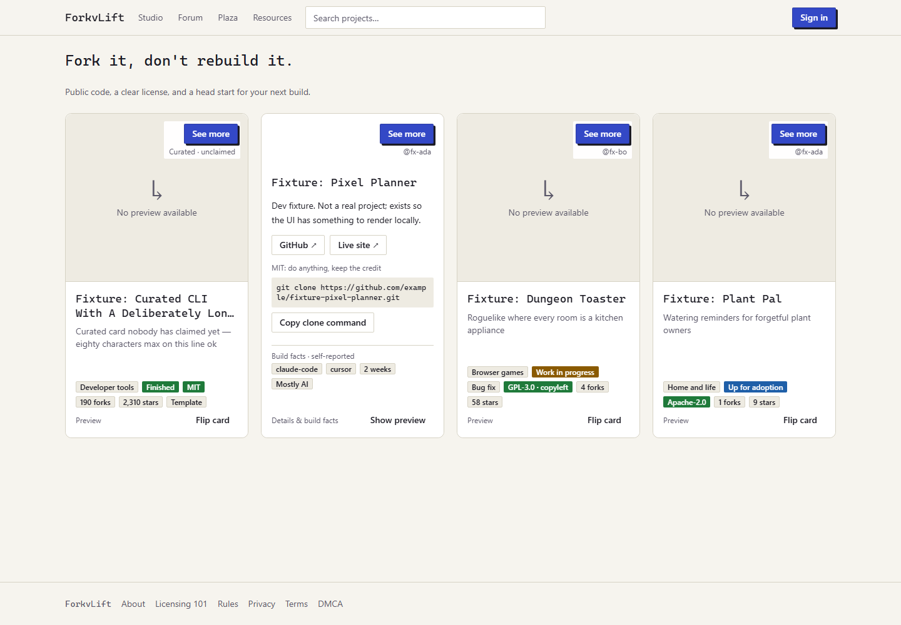 |
| Long description | 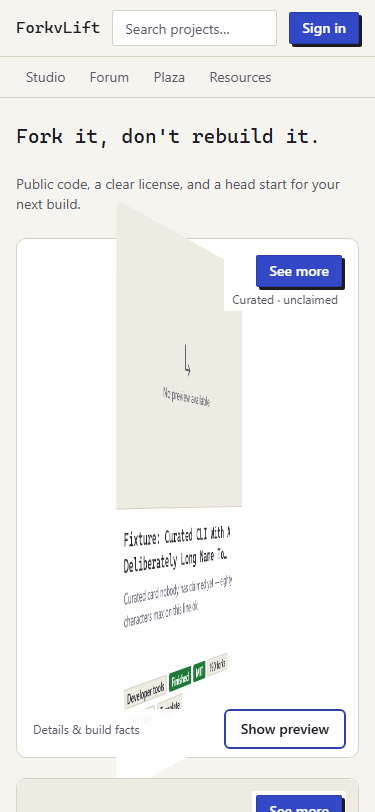 | 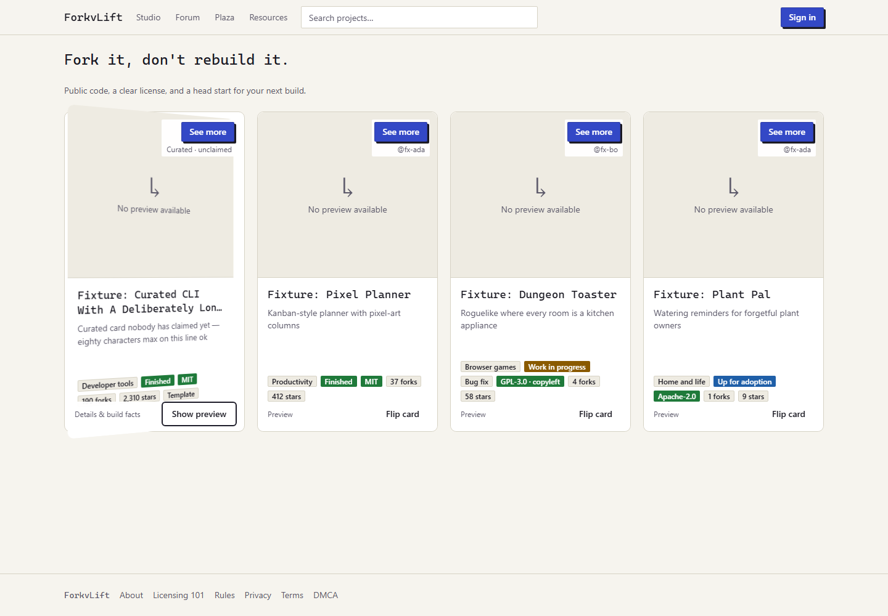 |
| No license | 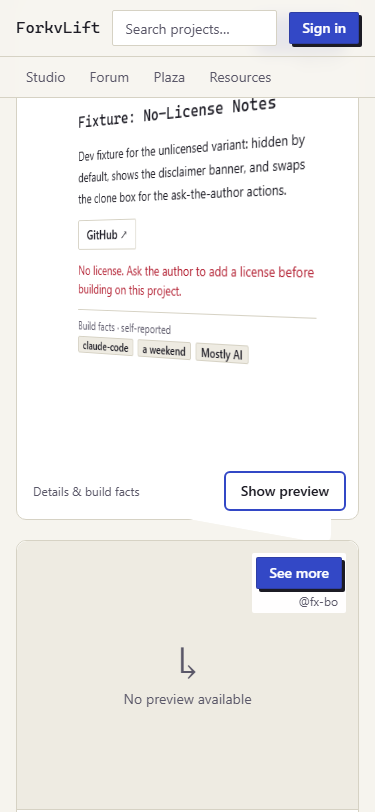 | 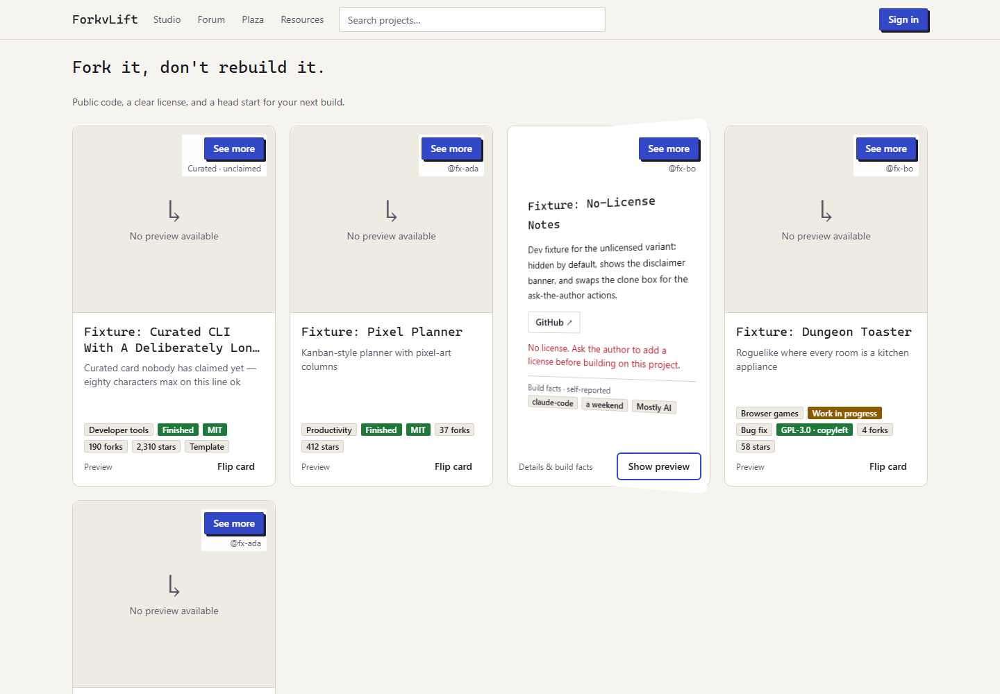 |
| Loading | 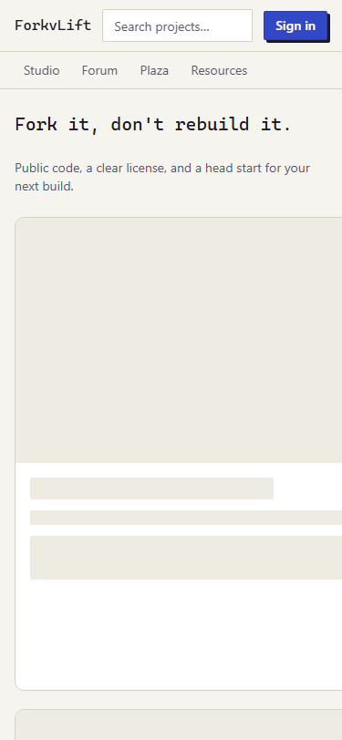 | 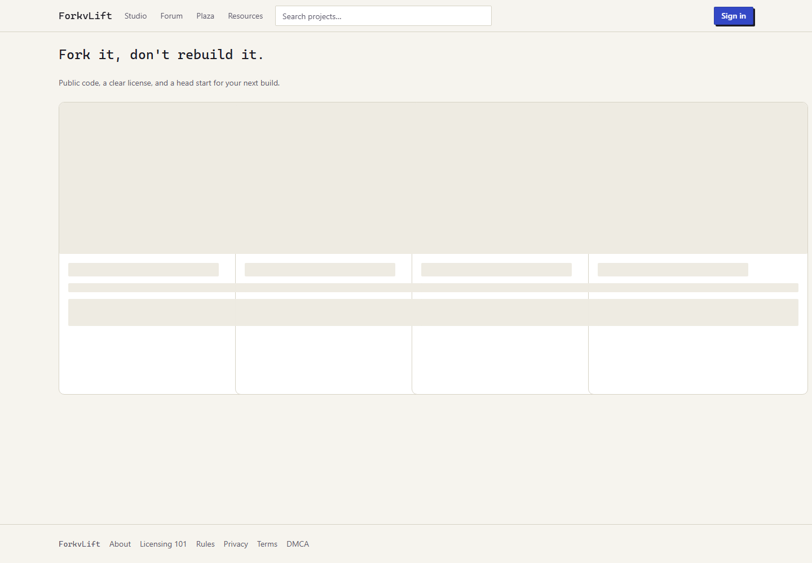 |
| Empty | 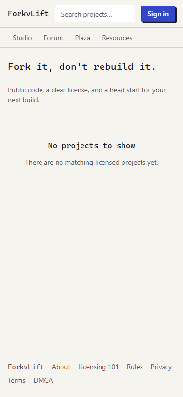 | 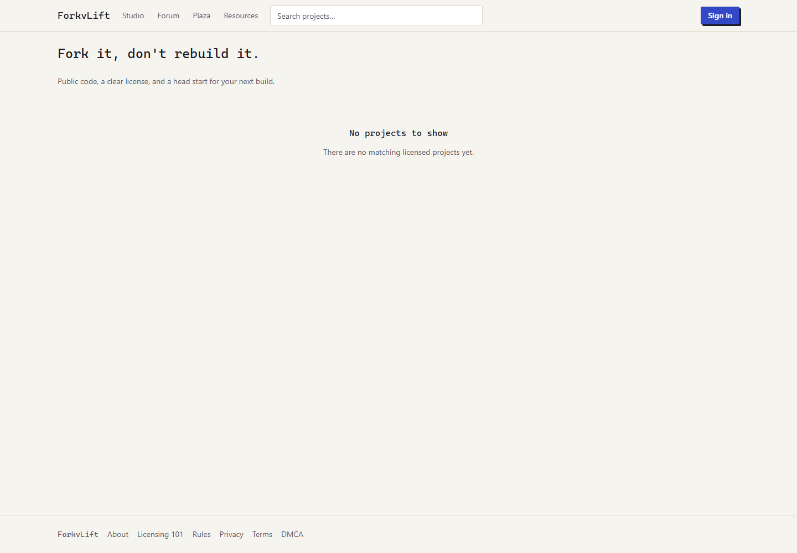 |
| Error | 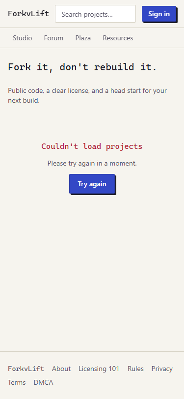 | 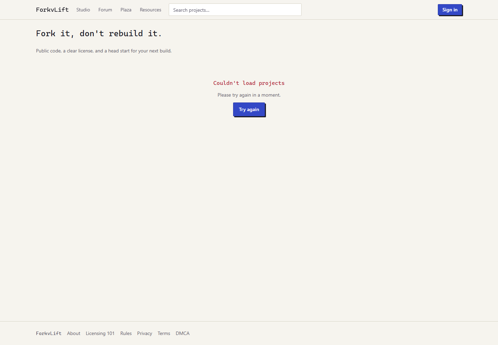 |

## Unfinished / integration

- Root Playwright dependency/script and CI wiring requested in `docs/contract-requests/sol-1.8-playwright.md`; no dependency/shared files changed.
- First-time license disclaimer switch/dialog belongs to 1.10; no opt-in UI ships in 1.8.
- Task 1.9 must merge after this card task; task 1.10 builds on this and the merged Projects API 1.2.
- No real catalog content is added; only Worker-served dev fixtures appear locally.
- Preview build reports the existing Worker env.preview R2 binding warning; no out-of-scope config change made.

